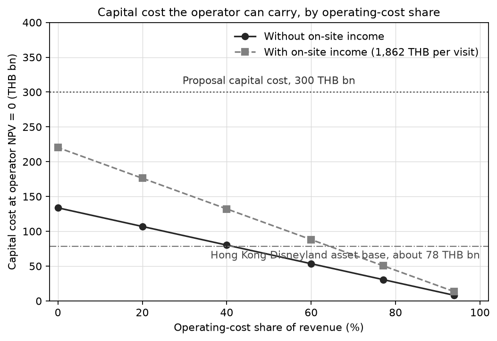
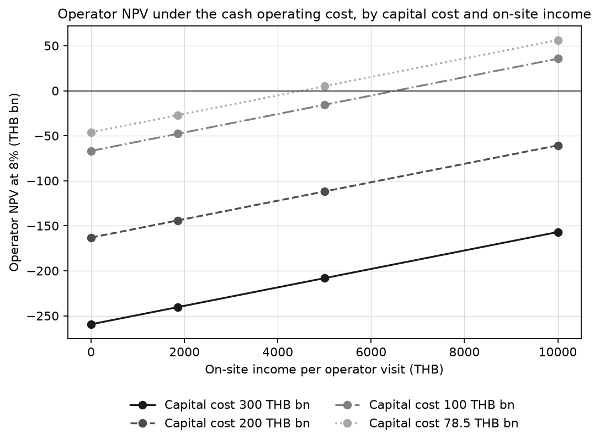
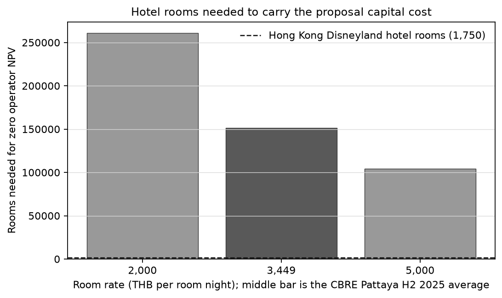

# Final results: financial and economic appraisal of the proposed theme-park complex

Date: 19 October 2026. Scope: finance economics (revision of 19 October 2026).

Model: `disney-tourism-thailand/src/dtt/appraisal.py`. Scenarios: `disney-tourism-thailand/scripts/appraisal_scenarios.py`. Code commits `f209377` and `3d85df1`.

## 1. Answer

The proposed complex, at its stated capital cost of 300 billion baht, does not produce a positive operator or national result under any case or scenario in this analysis. The capital cost that the operator can carry is much smaller than the proposal.

- Confirmed base case: operator NPV −281 billion baht at 8 percent; operator IRR −18.4 percent; national NPV −292 billion baht at 7 percent.
- Break-even capital cost (operator NPV = 0): about 8 billion baht on the confirmed cost structure; about 31 billion with the cash operating cost; about 50 billion with the cash operating cost and on-site income.
- The proposal's 300 billion baht is 3.8 times the non-current asset base of Hong Kong Disneyland, about 78 billion baht, for a park with 7.5 million visitors.
- A positive operator result therefore needs a capital cost of roughly 30 to 50 billion baht, with the cash cost structure, or a different scale and revenue base.

## 2. Inputs

| Input | Value | Status |
|---|---|---|
| Capital cost of the complex | 300 billion baht | Proposal figure from news reports; not verified |
| Confirmed assumptions (21 rows) | As in the assumptions table | Confirmed by the team on 19 October 2026 |
| Operating-cost share, confirmed | 0.9383 of ticket revenue | Generalized; includes Hong Kong Disneyland depreciation |
| Cash operating-cost share | 0.7712 of revenue | Sourced: costs and expenses before depreciation 6,705 over revenue 8,694 (Hong Kong Disneyland FY2025) |
| On-site income | 1,862 baht per operator visit | Sourced benchmark: Oriental Land FY3/2026 food, beverage and merchandise, 8,796 yen, at the Bank of Thailand JPY mid rate of 12 October 2026 (21.1734 baht per 100 yen) |
| Hong Kong Disneyland asset base | 78.5 billion baht | Sourced: non-current assets HK$18,396 million (FY2025) at the Bank of Thailand HKD mid rate of 19 October 2026 (4.2694 baht) |
| Hotel room rate and occupancy | 3,449 baht; 65.5 percent | Secondary: CBRE Pattaya H2 2025, asking rates for mid-range and above hotels |
| Hong Kong Disneyland hotel rooms | 1,750 rooms; 79 percent occupancy | Sourced: Annual Business Review FY2025 |

## 3. Results

### 3.1 Confirmed base and the labelled cases

Billion baht, at the discount rates of the appraisal (8 percent for the operator and fiscal ledgers, 7 percent for the national ledger).

| Case | Operator NPV | Operator IRR | National NPV | Fiscal NPV |
|---|---|---|---|---|
| Low (confirmed) | −284.8 | not defined | −255.3 | −280.6 |
| Base (confirmed) | −280.9 | −18.4% | −291.8 | −293.0 |
| High (confirmed) | −192.9 | −2.1% | −286.3 | −280.3 |
| Base with on-site income (labelled) | −275.8 | −15.8% | −291.8 | −293.0 |
| High with on-site income (labelled) | −148.0 | +0.6% | −286.3 | −280.3 |
| Base with cash operating cost (scenario) | −259.4 | −11.2% | −275.4 | not computed |
| Base, cash cost, with on-site income (scenario) | −240.3 | −8.0% | −275.4 | not computed |

### 3.2 Break-even capital cost by operating-cost share

Billion baht. The capital cost at which the operator NPV is zero.

| Operating-cost share | Without on-site income | With on-site income |
|---|---|---|
| 0.938 (confirmed) | 8.3 | 13.6 |
| 0.771 (cash cost) | 30.6 | 50.4 |
| 0.600 | 53.5 | 88.1 |
| 0.400 | 80.3 | 132.2 |
| 0.200 | 107.0 | 176.3 |
| 0.000 | 133.8 | 220.3 |

### 3.3 Capital cost under the cash operating cost

Operator NPV, billion baht.

| Capital cost | Without on-site income | With on-site income |
|---|---|---|
| 300 (proposal) | −259.4 | −240.3 |
| 200 | −163.1 | −144.1 |
| 100 | −66.8 | −47.8 |
| 78.5 (Hong Kong Disneyland asset base) | −46.2 | −27.1 |
| 50 | −18.7 | +0.4 |

### 3.4 Scale does not change the sign

The operator NPV is linear in the capital cost at fixed revenue. Under the cash cost, the present value of the operating margin with no capital cost is 29.5 billion baht. Each billion baht of capital costs 0.963 billion baht in present value, so the break-even capital cost is 30.6 billion. Scaling capital and revenue together leaves the sign of the NPV unchanged. Phasing a plan lowers the capital at risk only if the revenue per unit of capital rises.

### 3.5 Hotel income

At the proposal capital cost and the cash cost, the operator needs an extra 124.7 billion baht a year of room revenue to reach a zero NPV. At the CBRE average rate (3,449 baht, 65.5 percent occupancy) that requires about 151,000 rooms, which is 86 times the 1,750 rooms of Hong Kong Disneyland. At 2,000 baht the figure is about 261,000 rooms; at 5,000 baht, about 104,000 rooms.

### 3.6 National ledger

At the confirmed base, the present value of the benefit (the retained share of incremental net spending) is 3.4 billion baht. The economic costs are 203.1 billion for capital and 92.1 billion for operation, with the conversion factor of 0.7. The national NPV is −291.8 billion. Under the cash cost it is −275.4 billion. A zero national NPV needs incremental net spending about 81 times the model's figure: about 56 billion baht a year, against 0.69 billion.

### 3.7 Sensitivity of the confirmed base

Across the 25 NESDC sensitivity cases of the confirmed base, the operator NPV ranges from −197 to −364 billion baht. No case is positive.

## 4. Recommendation: how to make the project positive

1. **Reduce the capital cost to the level the operating margin can carry.** On the cash cost, the break-even is about 31 billion baht without on-site income and about 50 billion with it. That is roughly 40 to 65 percent of Hong Kong Disneyland's asset base. Phasing a 300 billion baht plan does not change the sign by itself (section 3.4).
2. **Decide the depreciation overlap.** The confirmed operating-cost share of 94 percent includes depreciation, and the capital cost is charged separately. Using the cash cost raises the operator NPV by 21.5 billion baht in the base case. This changes a confirmed assumption, so it needs the team's approval.
3. **Include on-site income with its cost of sales sourced.** The sourced benchmark of 1,862 baht per visit adds 19.1 billion baht to the operator NPV under the cash cost. The cost of sales of that income has no source yet.
4. **Do not rely on hotel income at this scale.** The room revenue needed to carry 300 billion baht is about 151,000 rooms at the CBRE rate.
5. **Address the volume.** The model caps operator visits at 4.9 million, against 7.5 million visitors at Hong Kong Disneyland. The cap comes from the airport and accommodation capacity in the model. Reaching a larger volume needs capacity the model does not include, and its source is needed.
6. **Decide the national benefit definition.** Under the ADB convention used in the model, the national NPV is negative at any realistic level of incremental spending. A positive national result needs a team decision to count visitor benefits beyond incremental spending. That is a methodological choice, not a computed fix.

## 5. Limitations and open items

- The proposal's capital cost of 300 billion baht comes from news reports and is not verified. It is the largest single driver of the result.
- The CBRE rates are asking rates for mid-range and above hotels, from secondary broker data.
- The Hong Kong comparators come from an operator's accounts in another market. The scale comparison is indicative.
- The 85 percent occupancy ceiling in the confirmed base is an assumption with no source.
- Operator visits are capped by the airport and accommodation capacity in the model.
- No tax on operator profit is modelled. The Hong Kong accounts show none.
- The results are scenario results, not forecasts.

## 6. Reproducibility

- Code: `disney-tourism-thailand/scripts/appraisal_scenarios.py` (commits `f209377` and `3d85df1`). Tests: `tests/test_appraisal_scenarios.py` and `tests/test_appraisal_onsite.py`. The appraisal and static tests pass (124 tests).
- Run from the project folder: `python scripts/appraisal_scenarios.py --json results.json --figures DIR`.
- Inputs: `data/appraisal/inputs.csv` (new rows for Hong Kong Disneyland FY2025, the Bank of Thailand HKD rate of 19 October 2026, and CBRE Pattaya H2 2025). `data/appraisal/assumptions.csv` is unchanged.
